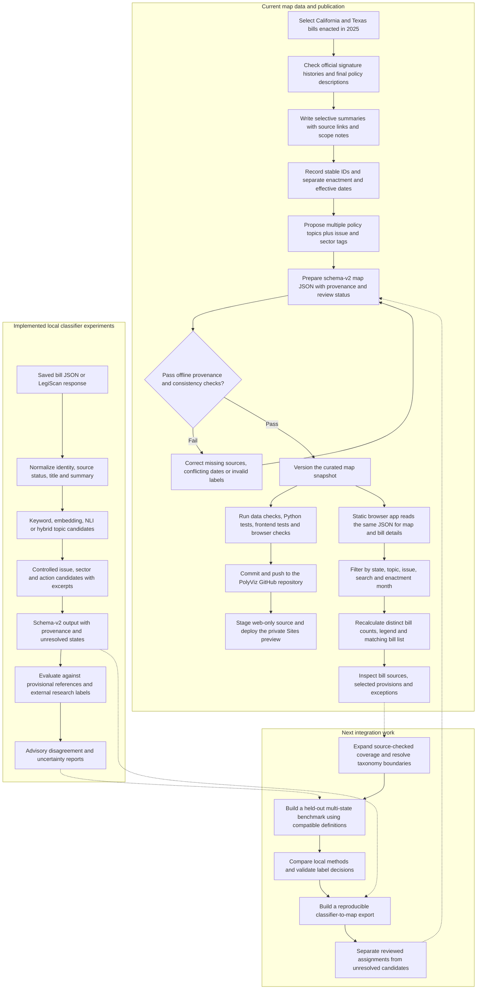

# PolyViz workflow

Updated November 18, 2026. The MVP is implemented and privately hosted. The current
map shows **17 selected 2025 enactments: nine from California and eight from Texas**.
It is a source-checked sample, not a complete session inventory or an accuracy benchmark.

## Overall workflow

Solid arrows show the current workflow. Dashed arrows show planned integration.
The classifier experiments and the map currently have separate data paths.



The offline gate checks metadata and consistency. It **does not prove** that a
summary is legally complete or that a topic label is correct. Source comparison
by an AI assistant is distinct from independent review.

## Current scope and inclusion rules

- Use a **2025 enactment-year slice**, not equivalent completed sessions: California's
  2025–2026 regular session and Texas's 89th regular session have different calendars.
- Include only the selected bills with checked historical signature dates. Current
  admission checks support `signed_by_governor`; other enactment paths need explicit
  handling before import.
- Keep resolutions, ceremonial measures, unknown statuses and undated enactments
  out of enacted-policy totals. Unknown status does not mean failure.
- Keep missing coverage distinct from zero matching bills. The rest of the US map
  has no sample coverage; it does not have zero legislation.
- Refresh manually. Nationwide coverage, scheduled ingestion, a database, topic-share
  comparisons and 3D are not part of the current MVP.

## Sources and accurate depiction

Use official bill histories, enrolled summaries, final legislative digests and
state agency materials. Governor announcements can substantiate signature events,
but package-level claims must not be attributed to an individual bill without support.
Prefer the final enacted version over an introduced or intermediate draft.

Each displayed summary has a source URL, section or page locator, check date and
checking method in `source_claims`. It is a selective paraphrase, not statutory
text. `summary_limitations` records qualifications and exceptions. Do not present
predicted savings or stated legislative goals as measured policy outcomes.

Examples in the current sample:

- California SB 57 authorizes a data-center cost-shift assessment; an earlier
  special-tariff proposal is not described as enacted.
- Texas HB 1481's school device restrictions retain disability, medical and safety
  exceptions in the summary.
- Texas SB 38 has separate effective-date events rather than a misleading single date.

Historical enactment does not establish current enforceability. Later amendments,
implementation, litigation and causal effects remain outside this snapshot.

## Canonical JSON and identifiers

Keep one record per state/session/bill identity. Preserve existing bill IDs;
classification changes do not create new bill identities. Distinct companions and
special sessions keep their own IDs. Source schemas and map display metadata are
documented in [schema version 2](SCHEMA_V2.md) and [the map README](../web/README.md).

| Field | Current role |
| --- | --- |
| `id`, `state`, `session_id`, `bill_number` | Stable identity and geography |
| `title`, `summary`, `summary_provenance` | Display text and its origin |
| `policy_topics` | Multiple direct policy topics from 16 controlled categories |
| `topics` | Compatibility alias of `policy_topics` |
| `issue_tags` | Specific issues, such as data centers or electricity rates |
| `affected_sectors` | Explicitly affected industries or institutions |
| `policy_actions` | Operative actions; empty in the current map sample |
| `dates` | Nullable introduced, enacted and effective ISO dates |
| `effective_date_events`, `effective_date_note` | Staged dates, scope and qualifications when established |
| `status`, `source_status` | Normalized status and original provider status when available |
| `sources`, `source_claims`, `status_verification` | Official references and checking provenance |
| `summary_scope`, `summary_limitations` | Selective scope and important qualifications |
| `classification` | Method, taxonomy version, evidence and review status |
| `issue_classification` | Classifier candidate evidence; not map assignments |

A data-center mention can support an issue tag and an affected-sector tag without
establishing technology policy. An energy requirement belongs under energy; a
sector-specific tax exemption belongs under taxation unless another provision
supports a separate topic. Empty assigned fields mean unresolved, not absent.

## Classification and evaluation

The local CLI accepts saved JSON, including LegiScan responses. It does not fetch
all states' legislation. Keyword classification is the default; embeddings, NLI
and hybrid methods are optional local experiments. All inference is free of paid
API calls. Downloads and optional model dependencies are needed on a fresh machine.

The expanded taxonomy is `data/topics-v2.json`; issue/sector/action definitions are
in `data/issue-taxonomy.json`. Preserve `data/topics.json` for historical ten-topic
experiments. New labels and rules need new evaluation; old scores do not establish
accuracy for the expanded taxonomy.

The map's current labels are **assistant-proposed source-based labels**, not a new
run of the classifier and not independently reviewed truth. No topic label in the
map sample has been independently reviewed. “Reviewed labels only” therefore has
an empty result.

The external reviewer learns published primary-topic codes from Pennsylvania.
Its source task and taxonomy differ from PolyViz's multi-label policy/sector task,
and the Florida transfer audit shows limited cross-state reliability. Use it as
an advisory signal, not an automatic verifier. See [automated review](AUTOMATED_REVIEW.md).

Next, compare methods using a held-out multi-state benchmark with explicit label
mappings and hard negatives. Deduplicate related text across splits, separate
training, validation and final testing, and report per-label precision/recall plus
unresolved coverage. Avoid tuning rules on every final-test error.

## Validation and browser aggregation

Before publication, run:

```sh
.venv/bin/python -m polyviz.map_data web/dist/data/bills.json
.venv/bin/python -m unittest discover -s tests -q
node --test web/tests/model.test.mjs
```

The map-data checker requires consistent identities and dates, supported labels,
official state source URLs, signature evidence, summary-to-source references and
scope notes. Reviewed labels require an independent review record. These checks
are offline admission checks; they do not automatically verify source meaning.

The browser counts distinct sample bills with enacted status and a known enactment
date on or before the selected month-end. State, topic, issue, search and review
filters narrow the list. State comparisons keep both states' counts under the other
filters. A multi-topic bill counts once in the selected view, not once per label.
The map, legend and details all derive from the same snapshot.

No topic-share or population-normalized measure is implemented. Counts do not
measure priorities, public support, policy significance or community outcomes.

## Implemented file organization

```text
polyviz/
  classifier.py                # Normalize saved inputs and classify topics
  schema.py                    # Schema migration and advisory issue candidates
  map_data.py                  # Map provenance and consistency admission checks
  evaluate.py                  # Multi-label evaluation
  external_review.py           # Research-label reviewer
  alignment.py                 # Advisory contextual crosswalk suggestions
  transfer_audit.py             # Cross-state reviewer audit
  review.py                    # Optional independent annotation workflow
data/
  topics.json                  # Preserved historical taxonomy
  topics-v2.json               # Active 16-topic taxonomy
  issue-taxonomy.json          # Controlled issues, sectors and actions
  raw/                         # Ignored source downloads
  generated/                   # Ignored experiment outputs
  model_cache/                 # Ignored downloaded model files
  models/                      # Ignored trained reviewer artifacts
examples/evaluation/           # Frozen experiments and limitations
tests/                         # Python tests
web/
  .openai/hosting.json          # Existing private Sites identity
  dist/
    index.html, style.css
    app.mjs, model.mjs          # Browser UI and filtering/count logic
    data/bills.json            # Curated 17-bill map snapshot
    data/topics.json           # Frontend taxonomy snapshot
    data/issues.json           # Frontend issue/sector/action definitions
    data/states.json           # Local SVG geometry; no map service token
  tests/model.test.mjs         # Frontend behavior and data checks
  README.md                    # Local running, data contract and extension notes
```

JSON is the current storage and delivery format. There is no database or server-side
application. Raw sources and model artifacts are excluded from Git and hosting.

## Website and publishing

The buildless static site is hosted on **Sites with owner-only access**:
[private PolyViz preview](https://polyviz-policy-atlas-jh.aridsong2.chatgpt.site).
Source is maintained in [PenguinYoi/PolyViz](https://github.com/PenguinYoi/PolyViz).

For local development, serve only the static output directory:

```sh
.venv/bin/python -m http.server 4173 --bind 127.0.0.1 --directory web/dist
```

Visitors select a state, topic or issue, search bills, and move the monthly timeline
or play it forward. Bill details expose selected provisions, source links, scope
notes and proposed-label status. The page also offers methodology and a JSON download.
Keep keyboard access, mobile layout, no-coverage styling and empty states working.

Validate and inspect the website before committing and pushing. For private hosting,
stage only the web project in an isolated publication checkout, push its exact source
state to the existing Sites source repository, save/package that version, and deploy
it. Preserve the project identity and private audience. GitHub pushes alone do not
currently update the preview; deployment is a separate step. Workflow-only changes
do not require republishing the web assets.

## Next milestones

| Milestone | Current state / next step |
| --- | --- |
| Schema and controlled vocabulary | Implemented; refine boundaries using evidence |
| Source-checked data pilot | 17 selected enactments in CA/TX; expand with the same provenance requirements |
| Map MVP | Implemented, privately hosted and pushed to GitHub |
| Reproducible pipeline-to-map export | Planned; connect classifier output without promoting candidates silently |
| Independent classification benchmark | Planned; current assistant and native-source references have limitations |
| Broader coverage | Expand only with documented completeness and status validation |
| Public release and scheduled refresh | Later; neither is enabled |

The immediate goal is a useful, inspectable map with defensible descriptions.
Community-needs alignment, causal policy-impact claims, live alerts, accounts,
and mandatory 3D remain outside this MVP.
