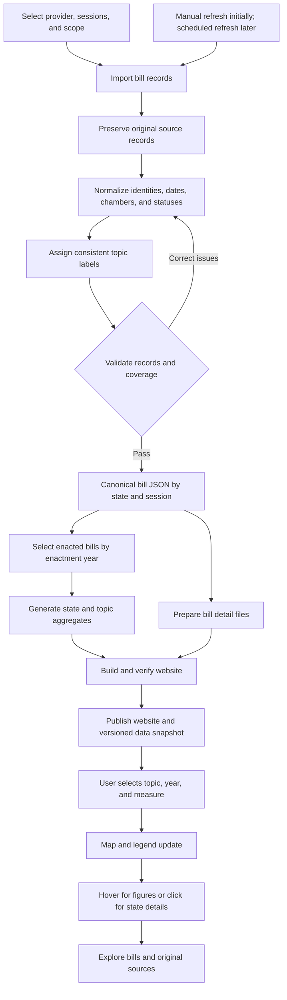

# PolyViz workflow plan

This document records the proposed workflow. Implementation choices remain provisional until the data pilot is complete.

## Overall flow



## 1. Define the scope

- Begin with one completed enactment year and a small set of topics.
- Pilot several geographically varied states before expanding nationally.
- Include bills enacted into law; exclude ceremonial resolutions from the main analysis.
- Retain other statuses if collected, but do not include them in enacted-law totals.
- Document whether special sessions and each measure type are included.

## 2. Acquire and preserve data

Evaluate a legislative data provider for coverage, status information, source links, historical availability, and reuse terms. Preserve unmodified downloads with acquisition timestamps. Keep credentials outside tracked files and published assets.

Candidate sources discussed include LegiScan and Open States/Plural. A provider has not been selected.

## 3. Normalize bill records

Use one canonical record per bill. A stable ID must distinguish state, session, and bill; bill numbers alone are not unique. Carryover bills should remain one record within their session. Separate companion bills retain separate identities, with a relationship recorded when available.

| Field | Purpose |
|---|---|
| `id` | Stable internal bill identifier |
| `state` | Two-letter state code |
| `session` | Provider's legislative session identifier or label |
| `bill_number` | Display identifier, such as HB123 |
| `measure_type` | Bill, resolution, or other source-supported type |
| `origin_chamber` | Lower, upper, unicameral, or unknown |
| `title`, `summary` | Display text; record summary provenance |
| `topics` | Array of controlled topic IDs |
| `classification` | Method, taxonomy version, review state, and optional model version |
| `status` | Normalized current status |
| `source_status` | Original provider status |
| `introduced_date`, `enacted_date` | ISO dates, or null if unavailable |
| `last_action` | Most recent action date and source description |
| `source` | Provider, provider bill ID, and source URL |
| `updated_at` | Time this record was refreshed |

Use an initial status vocabulary of `pending`, `enacted`, `vetoed`, `failed`, `withdrawn`, and `unknown`. Define provider-to-status mappings explicitly. A veto may later be overridden; update the final status from the action history. Do not infer failure solely from a lack of enactment. Enactment and effective dates are different; the initial map groups by enactment date.

## 4. Classify topics

Maintain a controlled taxonomy with stable IDs, display names, descriptions, and examples. Support multiple labels per bill. Distinguish unclassified records from classified bills outside the selected topic set. Preserve original provider subjects separately when available.

Choose and document the classification method after inspecting source data. Review a sample across states and topics, record errors, and refine the method before national expansion. If model-generated summaries or labels are used, record their provenance and validate them against source material.

## 5. Validate and aggregate

Check required fields, unique identities, allowed values, date formats, valid topic IDs, and source links. Verify enacted status and dates against a sample of original records. Record coverage by state and session; incomplete data must not appear as zero activity.

For a selected state and enactment year:

```text
topic count = distinct enacted bills tagged with that topic
topic share = topic count / all distinct enacted bills in the declared scope
```

Count a bill once within each topic, even if duplicate labels appear. Multi-topic shares may sum to more than 100%. Report the unclassified count alongside coverage information. If the denominator is zero, publish a null share rather than a misleading zero. Counts weight every bill equally; they do not measure policy significance.

Generate aggregates from canonical records. Never maintain totals manually. Reconcile aggregate counts with detail records before publication.

## 6. Proposed file organization

```text
data/
  raw/                         # Original downloads; publishing policy to be decided
  canonical/
    CA/2025-2026.json           # Illustrative state/session path
  topics.json                  # Controlled taxonomy
  coverage.json                # Completeness, omissions, and classification coverage
public/data/
  manifest.json                # Schema version, snapshot ID, and update time
  aggregates/2025.json          # Illustrative enactment-year totals
  bills/CA/2025-2026.json       # Public bill details with source links
scripts/                       # Import, normalization, classification, and export
docs/
  WORKFLOW.md
```

These are planned paths, not implemented components. Large raw datasets may require storage outside Git; decide after measuring their size. JSON is the initial storage and delivery format. Reconsider a database if incremental queries, full-text search, or frequent updates require one.

## 7. Website experience

1. Visitor selects topic, year, and count or share.
2. Map shading and legend update together.
3. Hover or keyboard focus reveals state figures.
4. Selecting a state opens a topic breakdown and bill list.
5. Selecting a bill reveals details and an original source link.

Use a flat map initially, with Alaska and Hawaii visible and accessible alternatives for small states. Provide keyboard navigation, readable contrast, responsive layouts, and an equivalent list or table. Display missing coverage distinctly. An optional 3D mode must represent a clearly labeled measure and retain a flat alternative.

## 8. Hosting and updates

Start with static hosting that supports HTTPS, repository-based deployments, and JSON assets. Choose the provider after choosing the frontend approach and checking current service limits. No host has been selected.

Before deployment, validate the data, build the website, and check map legends, filtering, state totals, source links, mobile layout, and keyboard use. Publish bill details and aggregates from the same snapshot so they remain consistent. Keep a previous release available for rollback. Refresh manually first; automate only after the pipeline is dependable.

## Milestones

| Milestone | Completion criteria |
|---|---|
| Scope and schema | Inclusion rules, taxonomy draft, status mapping, and record fields documented |
| Data pilot | Several states processed; coverage and classification sample reviewed |
| Interface prototype | Map, filters, tooltip, and state panel demonstrated with clearly labeled sample data |
| Integrated first version | Verified records drive the map; totals reconcile with bill details |
| Public release | Intended coverage published, limitations visible, usability checks passed, hosting configured |

## Decisions still open

- Data provider and initial enactment year.
- Pilot states and initial topic taxonomy.
- Classification and summary methods.
- Frontend and mapping libraries.
- Hosting provider and refresh cadence.
- Whether companion-bill duplication warrants an additional analytical view.

Community-needs scoring, causal policy-effect claims, accounts, live alerts, and mandatory 3D are outside the initial scope.
